# RF-BUDDY Esp32C3

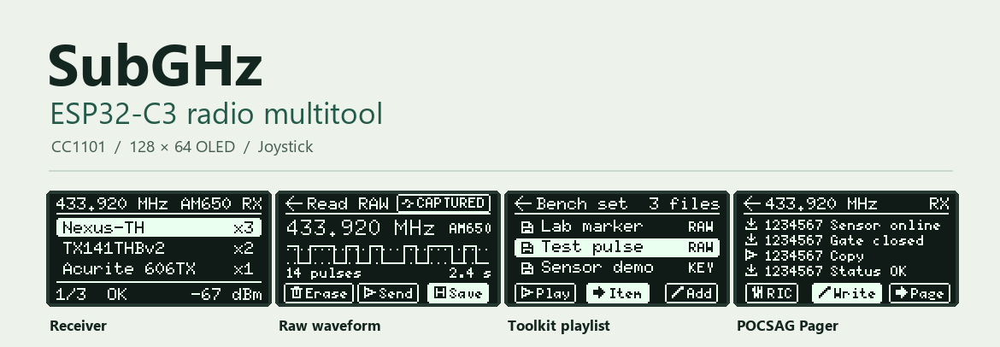

Handheld radio firmware for an **ESP32-C3**, **CC1101**, **SSD1306 OLED**, and analog joystick. Inspect activity, capture signals, and organize recordings on the device.

[UI gallery](#ui-gallery) · [Get started](#get-started) · [Hardware](#hardware) · [Serial CLI](wiki/Serial-CLI.md) · [Full manual](wiki/Home.md)

This repository contains documentation for the prebuilt firmware. Look for `firmware-merged.bin` in the repository’s **Releases** tab.

## UI gallery

The screens below are rendered from the firmware’s OLED drawing code with sample data. Wi-Fi names, BLE names, messages, and sensor readings are examples.

| [Read](wiki/Read.md) | [Read RAW](wiki/Read-RAW.md) | [Frequency Analyzer](wiki/Frequency-Analyzer.md) |
| :--- | :--- | :--- |
| 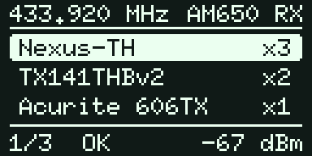 | 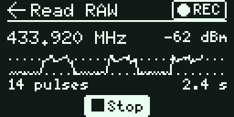 | 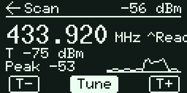 |
| Browse decoded signals and inspect the fields the receiver found. | See live RSSI, then inspect the pulse waveform or save it as a `.sub`. | Find an active channel, adjust the threshold, and tune the receiver. |

| [Signal Hunter](wiki/Signal-Hunter.md) | [Saved files](wiki/Saved.md) | [Sub-GHz Toolkit](wiki/Sub-GHz-Toolkit.md) |
| :--- | :--- | :--- |
| 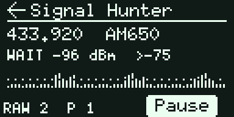 | 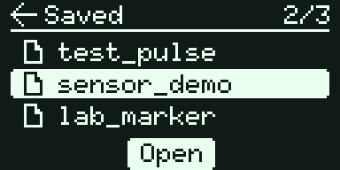 | 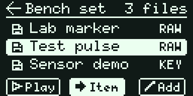 |
| Trigger a capture at a set signal level and automatically save the result. | Inspect, decode, rename, or replay supported recordings. | Organize playlists, change the order of files, and review a one-time scheduled send. |

| [POCSAG Pager](wiki/POCSAG-Pager.md) | [Sub-GHz Chat](wiki/Sub-GHz-Chat.md) | [Weather Station](wiki/Weather-Station.md) |
| :--- | :--- | :--- |
| 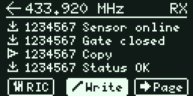 | 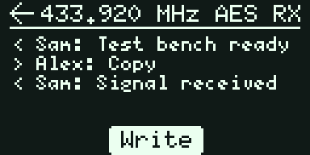 | 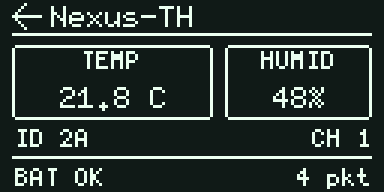 |
| Read and write pager messages from one conversation view. | Exchange text between compatible devices on the same channel. | Inspect temperature, humidity, battery status, and sensor channel. |

| [TPMS receiver](wiki/TPMS.md) | [Wi-Fi Recon](wiki/WiFi-Recon.md) | [BLE scanner](wiki/BLE-Tools.md) |
| :--- | :--- | :--- |
| 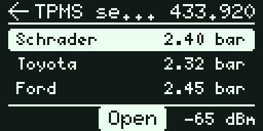 | 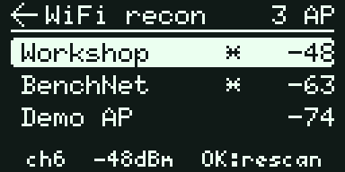 | 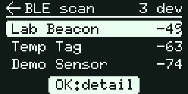 |
| View readings from supported tire-pressure sensors. | See nearby access points, channels, and signal strength. | Browse visible BLE advertisements and inspect device details. |

[Tesla Tools](wiki/Tesla-Tools.md) has two region buttons and shows which preset is active during the send.

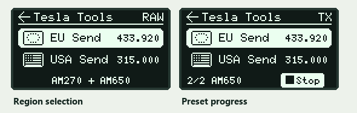

## Get started

1. **Wire the device.** Follow [Hardware & Wiring](wiki/Hardware-and-Wiring.md) for the CC1101, OLED, and joystick pins.
2. **Flash the merged image.** Select the ESP32-C3 serial port and write `firmware-merged.bin` at `0x0`. See [Flashing](wiki/Flashing.md) for CLI and browser instructions.
3. **Open Sub-GHz → Scan.** Use the joystick to navigate, press it briefly for **OK**, and hold it to go **Back**. The [navigation guide](wiki/Main-Menu-and-Navigation.md) shows where each app lives.

## Hardware

| Component | What to use |
| :--- | :--- |
| ESP32-C3 | Development board with native USB and 4 MB flash |
| CC1101 | SPI radio module with an antenna matched to the band |
| Display | 128 × 64 SSD1306 OLED over I²C |
| Joystick | Two analog axes and a push switch |
| Amplified CC1101, optional | GPIO2 can drive the module’s TX/RX switch |

<details>
<summary>Default GPIO pinout</summary>

| Signal | GPIO |
| :--- | :--- |
| OLED SDA / SCL | 8 / 9 |
| CC1101 SCK / MOSI / MISO / CS | 4 / 6 / 5 / 7 |
| CC1101 GDO0 | 20 |
| CC1101 PA T/R, amplified modules only | 2 |
| Joystick VRx / VRy / SW | 0 / 1 / 10 |

</details>

## USB console

Open a serial monitor at **115200 baud** to check the device or capture its OLED framebuffer.

```text
ping
status
open raw
shot
```

See the [Serial CLI reference](wiki/Serial-CLI.md) for commands and output formats, or [Troubleshooting](wiki/Troubleshooting.md) if the board fails to boot or enumerate.

## License and use

Independent hobby firmware for authorized testing. Use radio features only where you have permission and follow the transmission rules for your region. See the [firmware license](LICENSE).

## Credits

Inspired and helped by:

- **[Momentum Firmware](https://github.com/Next-Flip/Momentum-Firmware)** — feature-rich custom firmware for the Flipper Zero. Its Sub-GHz implementation and protocol handling guided much of this project’s decoding and UI.
