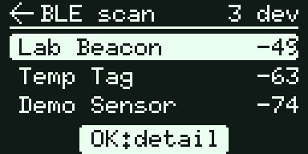

# BLE Tools

Bluetooth Low Energy toolkit on the ESP32-C3's built-in radio. Open the **BLE**
tile on the Home launcher to get the submenu.

## Scanner
Lists nearby BLE devices: name (or vendor / MAC), RSSI. **OK** opens a device
detail (MAC, manufacturer, service UUID, RSSI). **OK** again / rescan.

## Advertising spam
Broadcasts rapidly-changing advertising packets. Modes:
- **Apple AirPods** — pairing-popup spam (random models).
- **Apple Nearby** — "nearby action" popups (Setup new device, etc.).
- **Samsung Buds** — Galaxy buds popup.
- **Google FastPair** — Android pairing popup.
- **MS Swift Pair** — Windows pairing popup.
- **iBeacon** — broadcast random iBeacons.
- **Name Flood** — flood random device names.
- **Spam All** — cycle through the brands.

In a spam mode: **OK** pauses/resumes, the packet counter runs, **Back** leaves.

## Memory note
The ESP32-C3 shares RAM between Wi-Fi and BLE. Entering a BLE tool briefly turns
**Wi-Fi off** and frees the radio capture buffer so the Bluetooth controller has
enough memory; both are restored when you leave BLE. If memory is still too low
it shows "Low memory" instead of crashing.

## Notes
- Advertising spam is disruptive to nearby phones/PCs — authorised testing only.
- Under this firmware's BLE stack the MAC is not rotated per packet, so some
  phones may de-duplicate popups (less aggressive than a Flipper).
