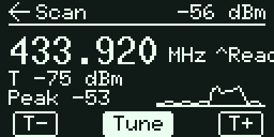

# Frequency Analyzer (Scan)

Finds the frequency a nearby transmitter is using by watching RSSI across a set
of common sub-GHz channels, then lets you jump straight into Read there.

## Use
1. Open **SCAN** (or `open analyzer`).
2. Hold a remote's button near the device; the strongest channel is detected
   and shown as a big frequency readout.
3. **T-" / "T+"** (Left / Right) lower/raise the trigger threshold — the button
   lights up in the direction you are adjusting.
4. **OK / Up** on a detected frequency tunes it and can jump into the receiver.

## Controls
| Key | Action |
|---|---|
| Left | `T-` lower threshold (less sensitive) |
| Right | `T+` raise threshold (more sensitive) |
| Down | cycle through recently detected frequencies |
| OK | tune / open the receiver on the selected frequency |

## Notes
- The detected frequency is snapped to the nearest standard channel.
- A small RSSI history sparkline shows recent activity.
- The trigger level is remembered between sessions.
- Over serial: `scan [start|stop]`.
