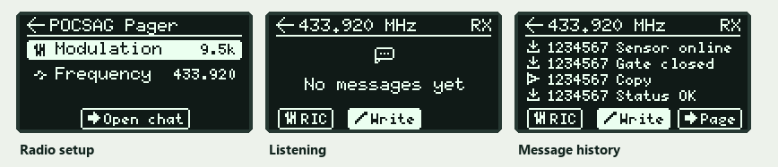

# POCSAG Pager

Read and write POCSAG messages from a single inbox.

1. Open **POCSAG Pager** from Tools. Choose **Frequency** and **Modulation**, then select **Open chat**.
2. Press **OK** to **Write**. The pager asks for the recipient’s RIC before the first send and remembers it for the rest of the session. Use **RIC** to change it.
3. Use **Up/Down** to browse the conversation and **Page** to inspect the selected message. **Use RIC** copies the address from a received page as the destination for a new message.

Preamble detection handles **512**, **1200**, and **2400 bps** on receive. The **Modulation** settings include deviation and TX rate. The radio returns to receive mode after transmission.

[← Back to the manual](Home.md)
