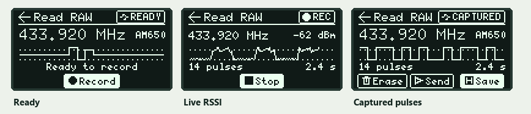

# Read RAW

Capture the radio’s pulse and gap timings, see the waveform, and save it as a `.sub` file.

| State | Screen | Controls |
| :--- | :--- | :--- |
| **Ready** | Frequency and preset | **OK** begins recording |
| **Recording** | Live RSSI, pulse count, and elapsed time | **OK** stops recording |
| **Captured** | Pulse waveform and capture metadata | **Left** erases, **OK** sends supported captures, **Right** saves |
| **Sending** | TX indicator and the captured waveform | **OK** toggles Repeat, hold **Back** to stop |

After recording, the screen may show a decoded protocol name or a warning if the buffer filled or pulses were dropped. For a 2-FSK recording, save the `.sub` so the preset travels with the capture.

For console capture commands, see [Serial CLI](Serial-CLI.md).

[← Back to the manual](Home.md)
