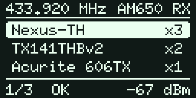

# Read (Receiver)

Auto-detecting receiver. Listens on the current frequency/preset and decodes
~90 sub-GHz protocols live, keeping a history of what it heard.

## Use
1. Open **READ** from the Sub-GHz menu (or `open read`).
2. Captured signals appear as a list (protocol + repeat count `xN`).
3. **Up/Down** select a history entry, **OK** opens its detail.
4. In detail, bottom buttons: **Send** (re-transmit) and **Save** (to `.sub`).

## Controls
| Key | Action |
|---|---|
| Left / Right | change RX frequency (manual scanner; turns off hopping) |
| Long OK | toggle frequency **hopping** (auto-scan across bands) |
| OK | open detail of the selected signal |
| Back (hold) | leave |

## Detail view
Shows the decoded fields of the selected signal:
- Protocol name + **bit** length, **Key** (full hex) and **Yek** (bit-reversed
  key) for generic protocols.
- Protocol-specific breakdowns where meaningful: KeeLoq (Fix/Hop/Manufacturer/
  Counter), CAME TWEE (Sn/Btn/DIP), CAME Atomo, Security+ 2.0, Nice, weather &
  TPMS-style sensors (channel/id/temp), etc.
- **TE** (timing element) and manufacturer where known.

## Notes
- Frequency hopping dwells on each band briefly and holds when it sees activity.
- "Send" rebuilds the waveform from the decoded key and transmits it; rolling-
  code remotes (e.g. KeeLoq) will not open a real receiver by replay.
- Over serial: `rx start`, `freq`, `fsk`, `lastdec`, `rssi`.
