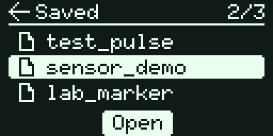

# Saved files

Browser for `.sub` files stored in the device flash (LittleFS `/subghz`).
Works for both **keyed** (decoded protocol) files and **RAW** recordings.

## Open a file
Select a file and press **OK** to get its action menu.

- **Keyed file** menu: **Send · Info · Delete · Rename**
- **RAW file** menu: **Send · Decode · Info · Delete · Rename**

## Info
Shows the full decoded detail, like the Read detail view:
- Keyed: Protocol, Frequency, **Bit**, **Key**, **TE**, **Manufacturer**,
  Seed, Key2 — whichever the file contains.
- RAW: frequency, modulation, pulse count and duration.

## Decode (RAW only)
Runs the stored RAW samples through all ~90 decoders and tries to identify the
protocol. On success it shows the guessed protocol and its fields; otherwise
"No protocol match". Handles recordings up to the 12000-sample capture size.

## Send
- **Keyed:** rebuilds the waveform from the key and transmits.
- **RAW:** replays the stored samples (OOK). 2-FSK RAW is not sent.
- While transmitting: keyed shows a **pulsing dot**, RAW shows a rolling
  **wave**. **OK** toggles **Repeat** (loop), **Back** (hold) stops.
  At the end of a single send, the app returns to the file’s action menu.

## Delete / Rename
Standard file management. Items inside a file aren't editable here — this is
whole-file management.

## Notes
- Over serial: `list`, `check`, `rawinfo`, `export`, `delete`, `rename`.
