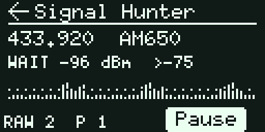

# Signal Hunter

An "auto-capture" receiver: it listens on the current frequency/preset and,
whenever RSSI crosses a trigger, records the burst (with a short pre-roll and
tail), tries to decode it, and saves the result automatically.

## Use
1. Open **Signal Hunter** from Tools.
2. It arms and waits. When a signal exceeds the threshold it records ~1 s
   before + the burst + ~1 s after.
3. It decodes the capture:
   - decoded → saved as `sigproto_NNNN.sub` (with the decoded fields),
   - not decoded → saved as `sighunter_raw_NNNN.sub` (raw samples).

## Controls
| Key | Action |
|---|---|
| Up / Down | raise / lower RSSI threshold (default ≈ −75 dBm) |
| OK | Pause / resume (or Retry a held capture) |
| Back | pause / leave |

## Display
- Live RSSI bar graph with a dotted trigger line.
- State: `BUFFER` (pre-roll) · `WAIT` (armed) · `REC` (recording) · `TAIL`.
- Counters `RAW`/`P` = raw vs decoded captures saved this session.

## Notes
- Sensitivity depends on your antenna; distant weak signals may not trigger.
  An amplified CC1101 (LNA) helps a lot (see [Hardware](Hardware-and-Wiring.md)).
- Saved files appear in [Saved](Saved.md).
