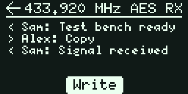

# Sub-GHz Chat

Encrypted peer-to-peer text chat over the CC1101, compatible with the
[e]subghz_chat wire format. Two devices on the same frequency and key can
message each other.

## Use
1. Open **Sub-GHz Chat** from Tools.
2. Set the **frequency** and the shared **key/passphrase** (both devices must
   match).
3. Enter the chat; type with the on-screen keyboard and send.

## Notes
- Messages are AES-encrypted (GCM) with the shared key; devices with a
  different key cannot read them.
- Uses GFSK. Range depends on antenna and environment.
- This is an independent, offline chat — no internet, no accounts.
