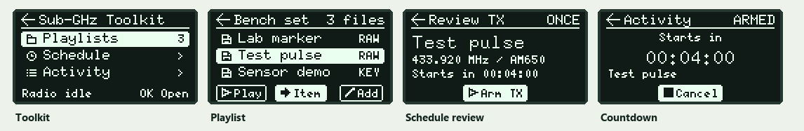
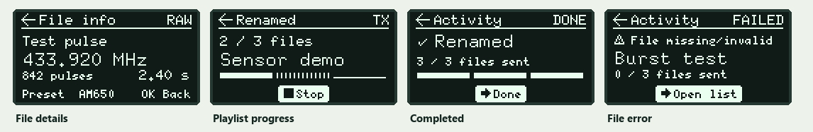

# Sub-GHz Toolkit

Use Toolkit to arrange saved `.sub` files into playlists and schedule a one-time send.

## Playlists

| Where | Left | OK | Right |
| :--- | :--- | :--- | :--- |
| **Playlists** | New playlist | Open the selected playlist | Edit its name or delete it |
| **Inside a playlist** | Play all files in order | Open the selected item | Pick a saved file to add |
| **Move signal** | | Confirm the new order | |

In **Move signal**, use **Up/Down** to preview the new position. Hold **Back** to discard the move. **File info** shows frequency and preset, plus pulse count and duration for RAW files. **Remove** asks for confirmation. Removing an item or deleting its playlist keeps the underlying `.sub` files in [Saved files](Saved.md).

## Schedule one file

1. Open **Schedule**, select a file, and open **Delay**.
2. Move between hours, minutes, and seconds with **Left/Right**. Change the active value with **Up/Down**, then press **OK** to save it.
3. Open **Review**. Check the filename, frequency, preset, and delay, then choose **Arm TX**.

**Activity** shows the countdown and offers **Cancel** while the send is queued. Playback displays the current file and the number of items completed. If a file cannot be loaded, Activity identifies the file and shows how far playback got.

[← Back to the manual](Home.md)
