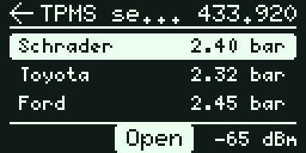

# TPMS

Tire-Pressure Monitoring System tool: receive live sensors, replay a captured
transmission, and **compose (spoof)** a frame with any ID / pressure /
temperature for a wide range of protocols.

## Setup
Open **TPMS** from Tools. On the Setup screen:
- **Frequency** — 433.920 MHz (EU) or 315.000 MHz (US).
- **Modulation** — OOK or 2-FSK (match the sensor family).
- **Listen** — start receiving.
- **Compose** — go to the spoof composer (below).

## Receive
Detected sensors are listed with pressure; **OK** opens a detail view showing
ID, pressure, temperature, battery and packet count.

## Replay
In a sensor's detail, **OK** replays the exact captured burst of that sensor
(works for any protocol, since it's a raw replay). Wait until a packet of that
sensor has been captured.

## Compose (spoof)
Build a frame from scratch — no capture needed:
1. Setup → **Compose**.
2. Fields: **Protocol** (Left/Right cycles all supported encoders), **ID**
   (hex), **Pressure** (±5 kPa), **Temperature** (±1 °C).
3. **OK** transmits. The encoder picks OOK/FSK automatically; frequency comes
   from the Setup 315/433 toggle.

The encoders are the exact inverse of the decoders, so a composed frame decodes
back to the ID / pressure (±1 step) / temperature you set. Some protocols have
inherent field limits (e.g. certain pressure fields saturate, a few sensors
expose only a 28-bit ID) — noted per protocol.

### Serial
- `tpmslist` — list every protocol.
- `tpmstx "<proto>" <idHex> <kPa> <tempC> [315|433]` — compose & transmit.
- `tpmsbuild "<proto>" <idHex> <kPa> <tempC>` — build only (read via `txslice`
  to verify with a host decoder).

Example: `tpmstx "toyota" 1A2B3C4D 240 21 433`

## Supported protocols
Schrader (several variants incl. EG53MA4, SMD3MA4, MRXBC5A4, motorcycle),
Renault, Citroen, Ford, Toyota, GM, Abarth 124, Honda, Kia, Hyundai VDO,
Elantra 2012, Nissan, BMW, BMW G3, Jansite (+ variants), Porsche, Truck,
Mercedes-Benz, Sefis M3, PMV-107J, AVE, Airpuxem, Steelmate, TRW, Gear/Hive,
Tyreguard 400, Smartire, EEZ RV, SP372, and more — see [Protocols](Protocols.md).

## Notes
- Spoofing TPMS can set false dashboard warnings. Test only on your own vehicle.
