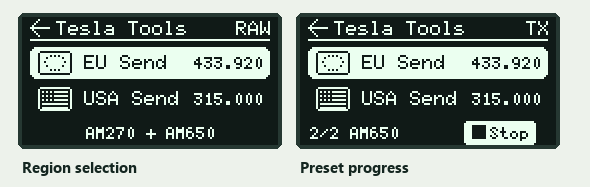

# Tesla Tools

Tesla Tools sends a charge-port request for the selected region.

| Button | Frequency | Sequence |
| :--- | :--- | :--- |
| **EU Send** | 433.920 MHz | AM270, then AM650 |
| **USA Send** | 315.000 MHz | AM270, then AM650 |

Use **Up/Down** to select a region and press **OK** to send. The footer shows the current preset and **Stop** during transmission.

[← Back to the manual](Home.md)
