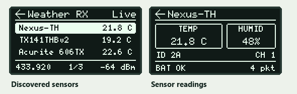

# Weather Station

Receives and decodes 433 MHz weather-sensor protocols (temperature / humidity
sensors such as Nexus-TH, Acurite, GT-WT, inFactory, and similar), and can
transmit a crafted reading.

## Use
Open **Weather Station** from Tools.
- **Receive** — listens and lists detected sensors with their temperature /
  humidity / channel / id.
- **Transmit** — pick a model and values and send a synthetic reading (useful
  for testing a receiver or display that expects these sensors).

## Notes
- These are OOK sensors; the decoders are ported from rtl_433.
- Weather files can also be queued for scheduled TX in the
  [Sub-GHz Toolkit](Sub-GHz-Toolkit.md).
