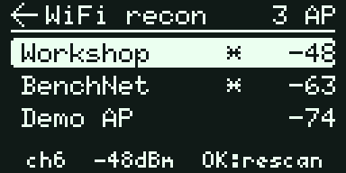

# Wi-Fi Recon

Passive scan of nearby 2.4 GHz Wi-Fi access points using the ESP32-C3's built-in
radio. Recon only — it does not transmit or attack.

## Use
Open the **Wi-Fi** tile on the Home launcher, then **Scanner** (the Wi-Fi tile now
opens a submenu: Scanner, File Transfer, Download DB, Wi-Fi Setup). It scans and
lists access points:
- **SSID** (or `<hidden>`), **RSSI** (dBm), `*` = secured, and the **channel**
  of the selected AP at the bottom.
- **Up/Down** select, **OK** rescan, **Back** leave.

## Serial
- `wifiscan` — returns `channel RSSI auth SSID` per AP.

## Notes
- Scanning does not drop an existing Wi-Fi connection used elsewhere.
- Deauth and active Wi-Fi attacks are intentionally not included.
